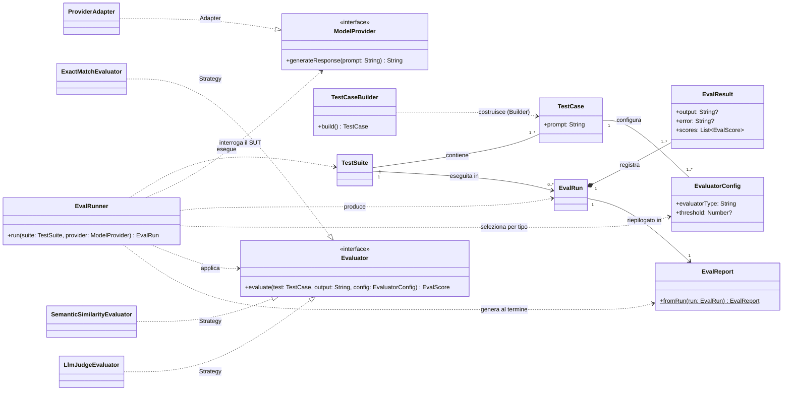

# Diagramma delle classi — POC

La lettura principale è **test → run → eval → report**. Il diagramma mostra le responsabilità e i tre pattern; gli attributi di persistenza e i dettagli del report restano nei [requisiti](./requirements.md).

- **Builder:** `TestCaseBuilder` costruisce un `TestCase`; la suite raccoglie i test creati.
- **Adapter:** `ModelProvider` è l'interfaccia interna verso il **SUT (System Under Test)**, cioè il provider/modello scelto per il run. `ProviderAdapter` adatta la sua API a questa interfaccia.
- **Strategy:** ogni `TestCase` configura uno o più evaluator. `EvalRunner` sceglie l'implementazione di `Evaluator` in base a `evaluatorType`, la applica all'output e registra gli score nel risultato.
- **Report:** al termine delle valutazioni, `EvalRunner` chiama il metodo statico `EvalReport.fromRun(run)`, che raccoglie risultati e score del run e restituisce il report. Il giudizio complessivo usa `OverallScoreEvaluator`, omesso dal disegno.

Le frecce tratteggiate indicano dipendenze o realizzazioni; il flusso test → run → eval → report è descritto dalle responsabilità, non da una sequenza temporale UML.
