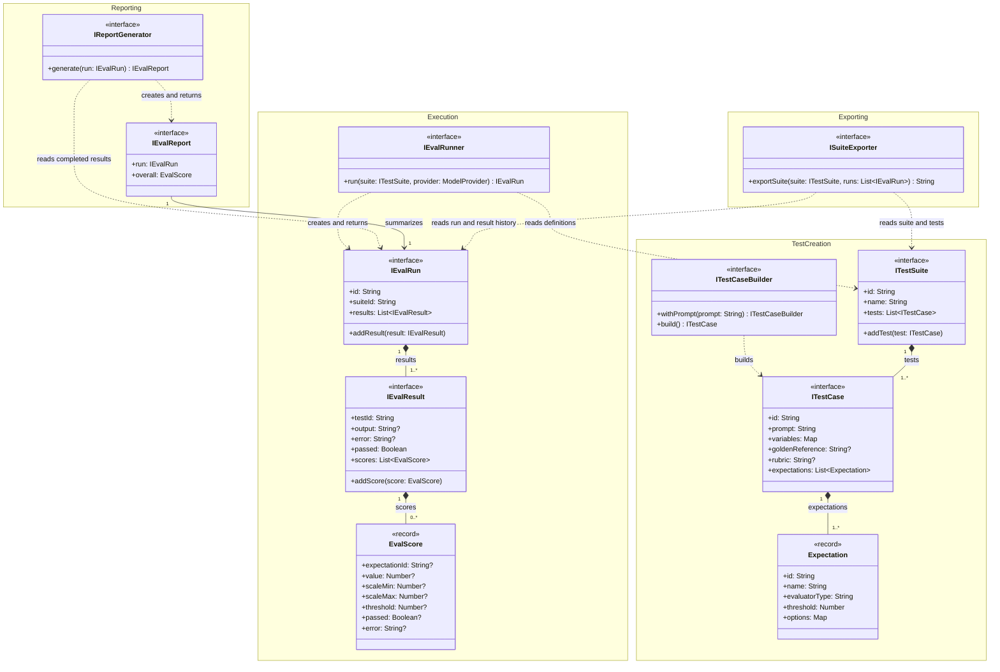
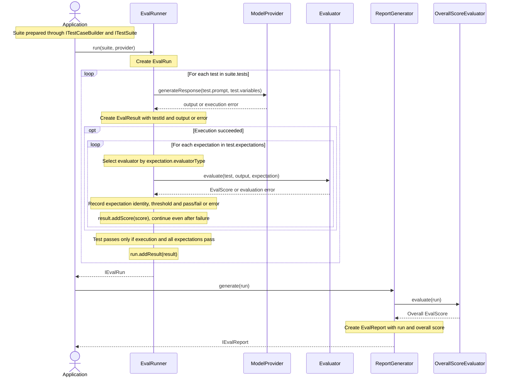
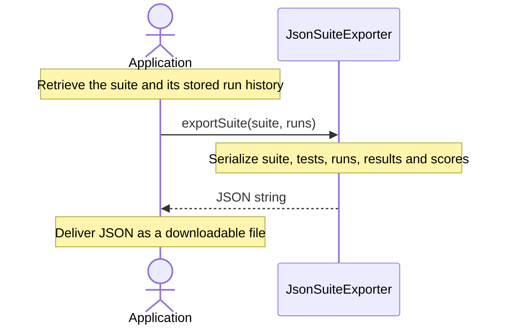
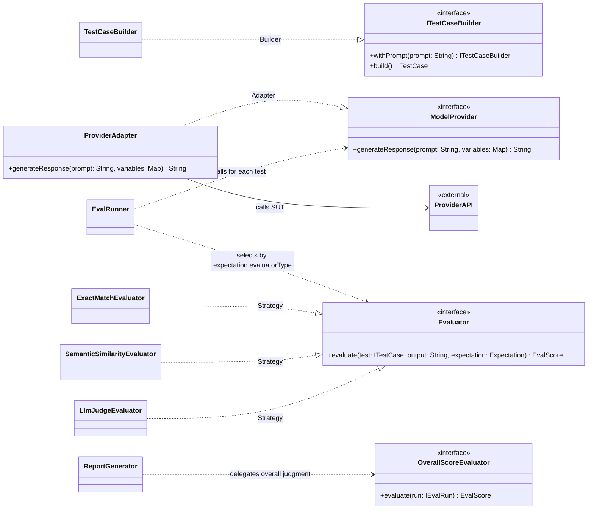

# Minimal Class Diagram — MVP

The domain has four logical subsystems: **test creation → execution → reporting**, plus independent **exporting**.
They communicate through public contracts in the same application, without additional subsystem wrapper classes.
Only essential fields and operations are shown. The [requirements](./requirements.md) remain the reference.

## 1. Subsystems and public contracts

| Subsystem | Public entry points | Output |
|---|---|---|
| Test creation | `ITestCaseBuilder`, `ITestSuite` | A configured `ITestSuite`. |
| Execution | `IEvalRunner.run(suite, provider)` | A completed `IEvalRun`, including results and scores. |
| Reporting | `IReportGenerator.generate(run)` | An `IEvalReport` with the results and overall judgment. |
| Exporting | `ISuiteExporter.exportSuite(suite, runs)` | A JSON string containing the suite, tests and run/result history. |

The diagram shows public contracts rather than duplicating every interface and its implementation. Namespaces represent logical subsystems, not deployment units or required directory layers. Arrows show structural dependencies; the sequence below shows execution order.



Concrete domain classes explicitly implement these contracts:

| Public contract | Implementation |
|---|---|
| `ITestCaseBuilder` | `TestCaseBuilder` |
| `ITestSuite` | `TestSuite` |
| `ITestCase` | `TestCase` |
| `IEvalRunner` | `EvalRunner` |
| `IEvalRun` | `EvalRun` |
| `IEvalResult` | `EvalResult` |
| `IReportGenerator` | `ReportGenerator` |
| `IEvalReport` | `EvalReport` |
| `ISuiteExporter` | `JsonSuiteExporter` |

### Responsibilities and dependency direction

- **Test creation:** the builder validates a test and assigns its UUID; `suite.addTest(test)` assembles the suite. `TestCase` defines input and criteria and has no `run` method. This subsystem knows no providers, runners or reports.
- **Execution:** `EvalRunner` coordinates the suite. For each test it calls the provider, creates an `EvalResult`, applies every configured evaluator to a successful output, adds the returned scores and stores the result in `EvalRun`. It returns the completed run and knows no report classes. `EvalRun` records execution data and provides `addResult`; it does not execute tests.
- **Reporting:** `ReportGenerator` reads the completed run, delegates the overall calculation to `OverallScoreEvaluator`, and creates `EvalReport`. The application supplies that strategy to the generator at construction. `EvalReport` is the final report object; it does not generate itself. This subsystem knows no runner, builder or provider implementations.
- **Exporting:** `JsonSuiteExporter` reads `ITestSuite` and its related `IEvalRun` objects and returns JSON containing the suite, tests, expectations, runs, results and scores. The caller retrieves the suite and its complete stored run history, which may be empty, and supplies them to `exportSuite`. Exporting is independent of execution and report generation and has no dependency on `EvalRunner` or `ReportGenerator`. The web interface handles downloading the returned JSON.

The application supplies available evaluators to the runner, keyed by evaluator type. An `Expectation` describes a configured check; an `Evaluator` is the algorithm that performs it. The runner selects that algorithm through the `evaluatorType` property. An expectation neither creates nor depends on evaluator implementations. Multiple expectations may use the same evaluator type with different parameters.

Each run also records its start time and provider/model names. It links to the suite through `suiteId`, and each result retains `testId`; neither requires a reference to the live suite or test object. Errors stay in their test's result and do not stop the following tests. A failed execution has no output to evaluate, so it may have no scores.

The report reads the run's results instead of copying them. Historical results retain recorded outputs and evaluations, without test versions or prompt snapshots.

### Test inputs and expectations

`ITestCase.variables` supplies values for placeholders in the prompt. `goldenReference` is the expected reference answer; `rubric` describes judgment criteria, for example for an LLM judge. The provider receives the prompt and variables; evaluators read the reference and rubric when needed. The builder checks that the selected expectations have their required criteria before creating the test.

`Expectation` is a plain configuration record with these properties:

| Property | Meaning |
|---|---|
| `id` | Stable identifier linking this check to its recorded outcome. |
| `name` | Readable label shown in reports and exports. |
| `evaluatorType` | Key selecting the evaluator algorithm. |
| `threshold` | Required minimum score to pass, on the evaluator's own scale. |
| `options` | Evaluator-specific parameters, such as a JSON schema; an empty map when unnecessary. |

For example:

```json
{
  "id": "EXP-01",
  "name": "Similarity to the reference answer",
  "evaluatorType": "semanticSimilarity",
  "threshold": 0.85,
  "options": {}
}
```

The reference answer and rubric remain on the test; options configure an individual expectation. Scale bounds belong to the returned score, not to the expectation.

### Recorded outcomes and pass/fail

`EvalScore` is also a plain record. The diagram shows a subset of its fields:

| Record | Fields |
|---|---|
| `EvalScore` | Expectation ID and name, evaluator type, value, scale minimum/maximum, applied threshold, pass/fail outcome, feedback and optional error. |

For each expectation, the runner records its ID, name, evaluator type and applied threshold with the outcome. A successful evaluation supplies the numeric value and scale; it passes when `value >= threshold`. An evaluator error produces a failed outcome with an error message and no numeric value or scale. The runner catches that error and continues with the remaining expectations.

A test passes only when execution succeeds and **all its expectations pass**. Every test has at least one expectation. `IEvalResult.passed` is derived from this rule, rather than set independently. A provider error fails the test and leaves its scores empty. A failed expectation never stops the remaining checks or tests.

Reports and JSON exports expose each test's pass/fail outcome and clearly identify every failed expectation by ID, name and evaluator type, with its score and threshold or error message. Recorded labels and thresholds remain available even if the test definition is later edited.

The overall strategy also returns an `EvalScore`, without an expectation ID or name. Expectation-specific fields are optional in the shared record, but required for individual expectation outcomes as described above. The overall formula remains part of the exercise and does not change individual test outcomes; scores with different scales cannot simply be averaged.

## 2. Application flows

### Execution and reporting

The application is the caller, for example an HTTP handler, not an additional domain class. It first prepares a suite through the creation contracts, then calls execution and reporting separately.



`EvalRunner` owns the two loops. Evaluators receive the test definition, output and expectation, and return a score; they do not receive or modify an `EvalResult`. The runner records the expectation metadata and applies the threshold rule. Reporting consumes the recorded results without calling the provider or repeating individual evaluations.

### Independent export

Export can be requested for an existing suite at any time, including before its first run. It does not require a new execution or report.



## 3. Required patterns



- **Builder:** create a valid test before adding it to the suite. Optional setters are omitted; a suite needs no builder of its own.
- **Adapter:** translate the external provider API into `ModelProvider`. The selected provider/model is the **SUT (System Under Test)**.
- **Strategy:** evaluator implementations vary the evaluation algorithm while the runner keeps the same loop. No factory or resolver class is needed.
- **Overall strategy:** the report generator delegates the overall judgment to its configured strategy. Its concrete implementation and formula remain part of the exercise; raw scores with different scales cannot simply be averaged.

## Implementation boundaries

Every TypeScript class and every Python domain class must explicitly implement the public contracts required by [AGENTS.md](../AGENTS.md). The table lists the core contracts; strategy and adapter contracts are shown in the pattern view. Plain records are data types. Both languages implement this same model.

Database storage remains required for suites, tests, runs and results. The exporting subsystem owns JSON serialization through `ISuiteExporter`; HTTP delivery, file download, database details and accessors are outside this domain view.
